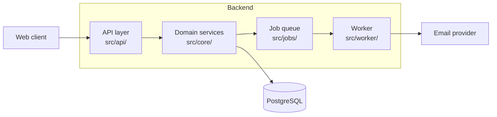
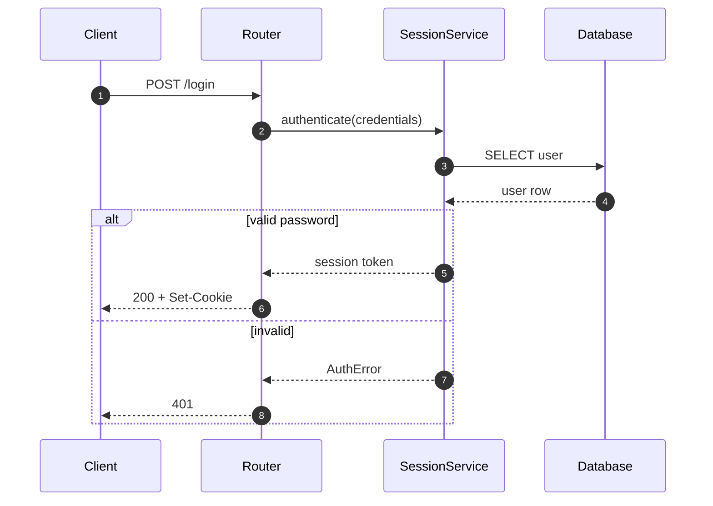
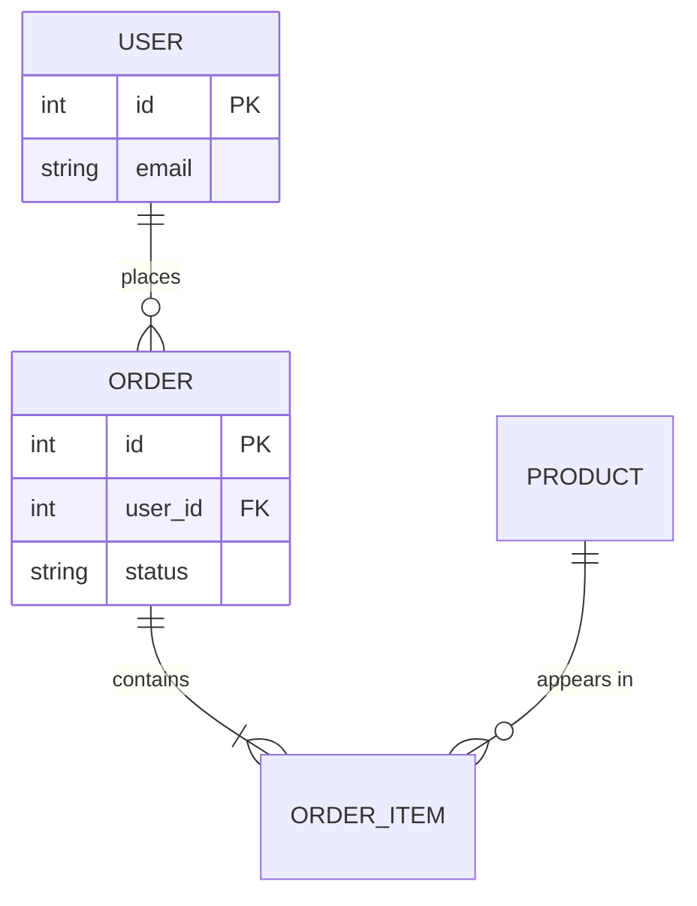
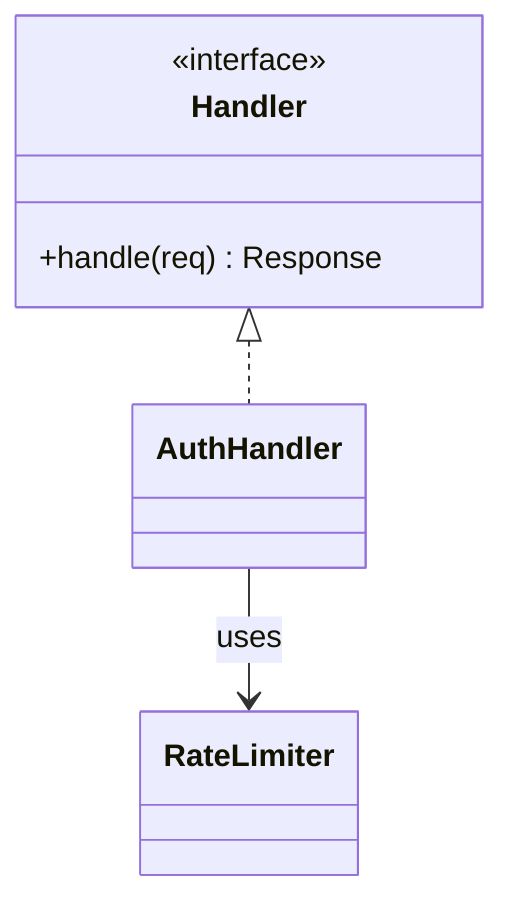
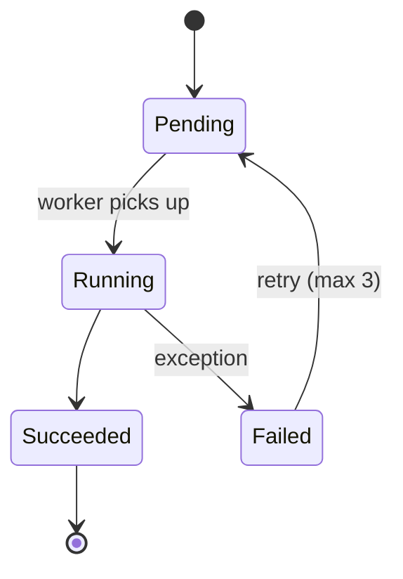

# Mermaid diagrams for repo wikis

A diagram earns its place when it shows something prose can't do compactly: how components depend on each other, how a request moves through them, how entities relate, or how state changes. Decorative diagrams dilute the wiki.

Rules that keep diagrams honest and renderable:

- **Every node is something you read.** Name nodes after real modules, classes or services, not generic boxes ("Business Logic"). Put the code location in the prose underneath: "Components shown: `src/api/` (routes), `src/core/` (domain), `src/db/` (persistence)".
- **Keep it small.** Aim for ≤12 nodes. Past that, split into one overview and one diagram per subsystem.
- **Quote labels** that contain spaces, parentheses, colons, slashes or punctuation: `A["auth/session (JWT)"]`. Unquoted special characters are the most common cause of "Syntax error in text".
- **IDs are plain alphanumerics** (`authSvc`), labels carry the readable text. Don't use `end` as an ID or label start in lowercase — Mermaid reads it as a keyword. Use `End` or `"end"`.
- **Line breaks in labels:** `<br/>` inside a quoted label. No other HTML.
- **Fence as ` ```mermaid`** and nothing else on the opening line. The linter checks that the first line is a known diagram type.
- After each diagram, one or two sentences saying what to notice. Diagrams without a takeaway get skipped.

## Component / architecture diagram



Use `LR` for pipelines and `TB` for layered stacks. `subgraph` groups deployables or layers; give it a quoted title. Cylinder `[( )]` for stores, `{{ }}` hexagon for external systems if you want them to stand out.

## Request / flow sequence



Use `participant X as Readable name` so message lines stay short. `->>` is a call, `-->>` a return. `alt/else`, `opt`, `loop` map to branches the code really has. Number the steps in the prose to match `autonumber`.

## Data model



Take entity and field names from the schema or ORM models and cite them. Relationship cardinalities: `||` exactly one, `o|` zero or one, `}o` zero or many, `}|` one or many. Quote relationship labels that contain spaces.

## Class / type relationships



Show only the types a reader must understand — public interfaces and the main implementations — not every class.

## State machine



Use it for job, order or connection lifecycles where the code has an explicit status field or enum; cite the enum.

## Common errors and fixes

| Symptom | Cause | Fix |
|---|---|---|
| "Syntax error in text" on a flowchart | Unquoted `(`, `)`, `:` or `"` in a label | `A["label (with) punctuation"]` |
| Diagram vanishes after a node | A node named `end` | Rename or quote |
| Edge label breaks parsing | `\|` or `)` in `-->\|text\|` | Use `-- "text" -->` form with quotes |
| Sequence participants out of order | Participants first appear in message order | Declare `participant` lines up front |
| Huge unreadable diagram | Too many nodes | Split per subsystem, keep the overview at ≤12 |
| `%%` comment shows up as text | Comment on same line as a statement | Put `%%` comments on their own line |
